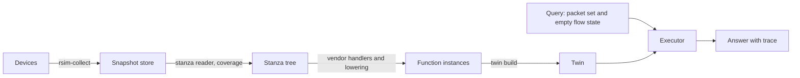

# rsim

rsim is a Rust engine for a network digital twin.

The engine compiles device configs and collected state into typed network functions. The functions stay in memory. The engine sends packets or packet sets through the functions to answer reachability questions and policy questions. Each answer has a full trace.

## Status

The engine has the core types, the network functions, the executor for single packets and packet sets, the trace and the return path. The packet sets use the decision diagram engine in `rsim-dd`. `rsim-collect` collects VyOS routers, UniFi consoles and NX-OS switches into the snapshot store. `rsim-ingest` builds a twin from the VyOS, UniFi and NX-OS data of a store, with one link join for all vendors. The packet sets can carry one encapsulation, with the inner header kept aside; EVPN and VXLAN in the twin are in progress. The command `rsim` and the MCP server `rsim-mcp` run queries on the built-in topologies and on the newest snapshot of a store.

## How the twin works

### The twin

The twin is an immutable set of function instances. Ingestion compiles it from one snapshot of the store. A snapshot holds the configs and the collected state of each device at one time: the route tables, the ARP table, the MAC table and the links.

- The twin holds the functions of all devices of the snapshot, not only the functions of one flow.
- The twin does not change after the build. A new snapshot gives a new twin.
- The twin is not persisted. The snapshots are persisted, and the engine builds the twin again from them.
- Each function keeps the source spans from which it came: the file and the line range of the config stanza or the collected row.

### The two kinds of state

| State | Where it is | Lifetime |
|---|---|---|
| Network state: config, routes, ARP, MAC table, links | In the functions of the twin | Fixed for the snapshot |
| Flow state: sessions, NAT translations | A `FlowState` value that the query carries | Only while the query runs |

A function does not keep flow state. The executor gives the flow state to a function as a value, and the function returns the new value on each branch. For example, `SessionCommit` adds a session to the value, and the reply path reads this session. Thus many queries can use the same twin, and the result does not depend on the order of the queries.

### From device to answer

1. **Collection.** `rsim-collect` reads each device with read-only commands and writes the answers to the append-only snapshot store. Only this crate talks to devices.
2. **Ingestion.** The stanza reader changes each config into a tree of stanzas. The coverage table of the vendor classifies each stanza as handled, known-irrelevant or unhandled. No stanza is dropped silently.
3. **Lowering.** The vendor handlers read the handled stanzas, and the lowering changes them and the collected rows into function instances. The vendor defaults come from the vendor profile. There is no vendor-neutral model between the stanzas and the functions.
4. **Build.** The twin build validates the composition of the functions. A link to a function that does not exist, or a context attribute that no earlier function supplies, is a build error.
5. **Query.** The executor starts at the ingress function with the packet set of the query and an empty flow state. Each function splits its input into branches, and each branch names the next function. The executor follows each branch to its outcome.
6. **Reply.** For each delivered branch, the executor starts the reply with the flow state of that branch.

### Generic function sequence of a router

A routed packet goes through these functions in sequence. Lowering leaves out `PolicyRoute` if the device has no policy routes. A function with no rules on a device lets all packets pass.

| Function | What it does with the packet set |
|---|---|
| `Ingress` | Records the ingress interface. |
| `VrfSelection` | Sets the VRF from the interface. |
| `ZoneLookup` | Sets the source zone. |
| `SessionLookup` | Passes the packets of a session in the flow state. |
| `DestinationNat` | Rewrites the destination address and port. |
| `PolicyRoute` | Selects a route table by policy. |
| `RouteLookup` | Splits the set by next-hop group. Equal-cost paths give a forwarding choice. Packets to the router go to `LocalInput`. |
| `ZoneLookup` | Sets the destination zone. |
| `FirewallPolicy` | Splits the set into accepted and dropped packets, with the rule that decided. |
| `SourceNat` | Rewrites the source address and port. |
| `SessionCommit` | Adds the session to the flow state. |
| `NextHopResolution` | Finds the egress interface and the MAC of the next hop. |
| `Egress` | Sends the set on the link to the next device. |

On a switch, the sequence is `PortIngress`, `MacLookup`, and `PortEgress` or `Flood`. `Layer3HandOff` gives the packets from a switch port to the ingress of a router.

### Unknown results

If the engine cannot be sure, the result is `Unknown` with a reason. This occurs, for example, when a function came from an unhandled stanza, or when the result depends on a field that the query does not state. `Unknown` applies only to the packets that the uncertainty can affect.

## Principles

- If the engine cannot be sure, it returns `Unknown` with a reason.
- The same input gives the same output.
- Each function keeps the source lines from which it came.
- Vendor defaults are data in vendor profiles.
- Functions contain no buffers, timers, queues or I/O.
- Functions calculate the delay as virtual time.
- Functions calculate the QoS marking, the traffic class, the selected queue.
- A policer or a shaper adds a rate condition to the branch. The engine does not simulate rates.

## Crates

| Crate | Contents |
|---|---|
| `rsim-core` | Packets, packet sets, context, flow state, outcomes, traces |
| `rsim-dd` | Reduced ordered binary decision diagrams with complement edges, for the packet sets |
| `rsim-functions` | The network function library: forwarding, layer 2, routing, ACL, firewall policy, NAT, sessions |
| `rsim-engine` | The twin, the executor, verdict aggregation, the return path |
| `rsim-store` | The append-only snapshot store: the format, the writer and the reader |
| `rsim-collect` | The collectors: SSH and HTTPS transports, jump hosts and proxies, the vendor sources |
| `rsim-ingest` | The stanza reader, the coverage report and the lowering of each vendor into functions |
| `rsim-topologies` | The hand-built topologies for the tests, the benchmarks, `rsim` and `rsim-mcp` |
| `rsim-cli` | The command `rsim`: path queries and set queries with text output and versioned JSON output |
| `rsim-mcp` | A Model Context Protocol server on stdio with the tools `list_devices`, `path_query`, `set_query` and `explain_step` |

## Build

You need Rust 1.99 or later.

| Task | Command |
|---|---|
| Build | `cargo build --workspace` |
| All tests | `cargo test --workspace` |
| One test file | `cargo test -p rsim-engine --test forwarding` |
| One test | `cargo test -p rsim-engine --test forwarding <test_name>` |
| Lint | `cargo clippy --workspace --all-targets` |
| Format check | `cargo fmt --all --check` |
| Path query benchmark | `cargo bench -p rsim-engine --bench single_path` |
| Memory per device | `cargo bench -p rsim-engine --bench memory` |
| Decision diagram operations | `cargo bench -p rsim-dd --bench ops` |

## Path queries with rsim

`rsim` loads a built-in topology by name. The names are `mini-enterprise`, `edge-dnat`, `ecmp`, `routing-loop`, `hairpin` and `chain`.

| Task | Command |
|---|---|
| List the topologies | `cargo run -p rsim-cli -- topologies` |
| List the devices, functions, endpoints and attachment records | `cargo run -p rsim-cli -- devices mini-enterprise` |
| Run a path query with its reply | `cargo run -p rsim-cli -- path mini-enterprise --source.ip 172.31.10.20 --destination.ip 10.20.0.53 --network.transport udp --source.port 40000 --destination.port 53` |
| Show one trace step | `cargo run -p rsim-cli -- explain mini-enterprise --source.ip 172.31.10.20 --destination.ip 10.20.0.53 --network.transport udp --destination.port 53 --branch 0 --step 7` |
| Show one trace step of the reply of branch 0 | Add `--reply-of 0` to the `explain` command |
| Get JSON | Add `--format json`. Add `--pretty` for indented JSON. |
| Run a set query | `cargo run -p rsim-cli -- set mini-enterprise --source.ip 172.31.10.0/24 --destination.ip 10.20.0.53 --network.transport udp,tcp` |
| Show one trace step of a set query | Use `explain-set` with the flags of `set`, `--branch` and `--step` |
| Show all flags | `cargo run -p rsim-cli -- path --help` |

The query flags use the names of the Elastic Common Schema where it has one: `--source.ip`, `--destination.ip`, `--network.iana_number`, `--network.transport`, `--source.port`, `--destination.port`, `--source.mac`, `--destination.mac` and `--network.vlan.id`. The other flags are `--l2_priority`, `--tcp_flags`, `--icmp_type`, `--icmp_code`, `--dscp`, `--ecn`, `--fragment`, `--ingress` and `--no-reply`. `--tcp_flags` takes a comma-separated list, for example `syn,ack`.

- A path query needs `--source.ip`, `--destination.ip`, and `--network.iana_number` or `--network.transport`.
- `--ingress <device>/<interface>` states where the packet enters. Without it, the attachment records of the source address give the ingress. A source address on a connected network of an edge interface gives an ingress with a host that is not confirmed.
- A field that the query does not state is not known. If the result depends on such a field, the summary is `unknown`. The branches show each part exactly.

A set query takes the same flags, and each flag takes a set: an address, a prefix, a number, a range such as `1-1023`, or a comma list. A field that is not given has all values. The answer has a part for each different result, with the exact set of packets of the part.

The exit code is 0 if the engine gave an answer. `Drop` and `Unknown` are answers. The exit code is 1 for a query error and 2 for a usage error.

The JSON output has the field `rsim_json` with the version number 2. The same query gives the same bytes. A packet set is a list of members, and each member is a product of field values.

## MCP server

`rsim-mcp` is a Model Context Protocol server with the stdio transport. It supports the protocol revisions `2026-07-28` and `2025-11-25`. It writes only protocol messages to stdout and its log to stderr. It writes no files.

1. Build the server with `cargo build --release -p rsim-mcp`.
2. Add `target/release/rsim-mcp` to your MCP client as a stdio server with no arguments.

| Tool | Arguments | Result |
|---|---|---|
| `list_devices` | `topology` | The devices, functions, endpoints, attachment records and edge interfaces |
| `path_query` | The query fields of `rsim path` with the same names: `topology`, `source.ip`, `destination.ip`, the protocol and the optional fields | The answer with the ingress, the trace and the reply |
| `set_query` | The query fields; each takes a set | The parts of the set with their results, the traces and the replies |
| `explain_step` | The query fields, `branch`, `step`, the optional `reply_of` and `mode` (`path` or `set`) | One trace step. The tool runs the query again. |

The JSON of a tool result is the same as the output of `rsim` with `--format json`.

## License

MIT
