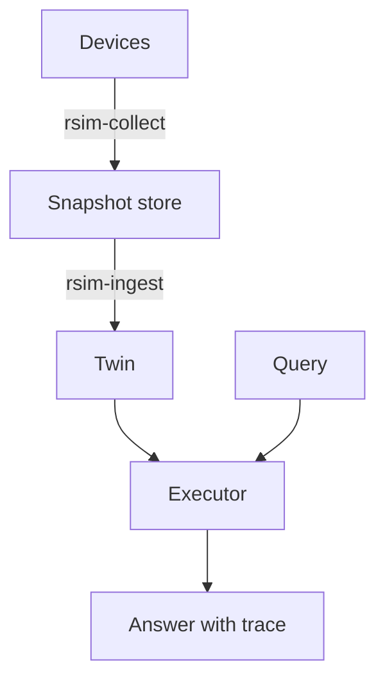
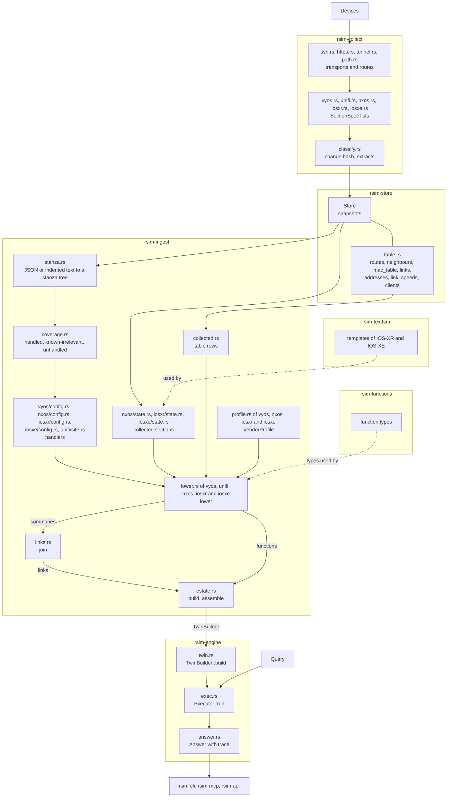
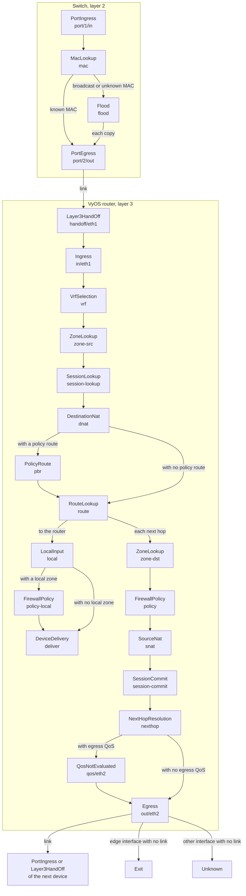

# rsim

rsim is a Rust engine for a network digital twin. It compiles device configs and collected state into network functions, and sends packets or packet sets through them. Each answer has a trace.

## How it works



1. `rsim-collect` reads each device with read-only commands and writes the answers to a snapshot store, which keeps the snapshots of the last 30 days by default and always the newest snapshot.
2. `rsim-ingest` reads one snapshot. It classifies each config stanza as handled, known-irrelevant or unhandled, and lowers the handled stanzas and the collected rows into function instances.
3. The twin build checks the composition of the functions. The twin is immutable and is built again from the store.
4. The executor sends the packet set of the query from the ingress function. Each function splits its input into branches, and the executor follows each branch to its outcome. For each delivered branch, it then runs the reply.

Sessions and NAT translations are in a `FlowState` value that the query carries. Each function keeps the file and the line range from which it came. A result that the engine cannot decide is `Unknown` with a reason.

### Modules



### Router functions

The function chain of a VyOS router behind a switch port. Each box is one function instance with its id.



| Function | Action on the packet set |
|---|---|
| `Ingress` | Records the ingress interface. |
| `VrfSelection` | Sets the VRF from the interface. |
| `ZoneLookup` | Sets the source zone. |
| `SessionLookup` | Passes the packets of a session in the flow state. |
| `DestinationNat` | Rewrites the destination address and port. |
| `PolicyRoute` | Selects a route table by policy. |
| `RouteLookup` | Splits the set by next-hop group. Equal-cost paths give a forwarding choice. Packets to the router go to `LocalInput`. |
| `ZoneLookup` | Sets the destination zone. |
| `FirewallPolicy` | Splits the set into accepted and dropped packets, with the rule that decided. |
| `SourceNat` | Rewrites the source address and port. |
| `SessionCommit` | Adds the session to the flow state. |
| `NextHopResolution` | Finds the egress interface and the MAC of the next hop. |
| `QosNotEvaluated` | Forwards the packets of a QoS stanza that is not evaluated. Makes the DSCP, the ECN, the traffic class and the queue unknown. |
| `Egress` | Sends the set on the link to the next device. |
| `LocalInput` | Sets the local zone as the destination zone of the packets to the router. |
| `DeviceDelivery` | Delivers the packets to the router. An encapsulated packet is `Unknown`. |

A switch uses `PortIngress`, `MacLookup`, and `PortEgress` or `Flood`. `Layer3HandOff` gives the packets from a switch port to a router.

A VXLAN tunnel end uses `VxlanEncap` and `VxlanDecap`. `VxlanEncap` puts the packets of a VRF or a bridge domain in an outer header to the peer tunnel end, and the underlay routes the outer header. `VxlanDecap` takes the packets to a local tunnel end out of the tunnel, and the VNI selects the VRF or the bridge domain. `MulticastLookup` replicates the packets to a multicast group to the outgoing interfaces of the collected multicast routes, after the reverse path check.

## Crates

| Crate | Contents |
|---|---|
| `rsim-core` | Packets, packet sets, context, flow state, outcomes, traces |
| `rsim-dd` | Reduced ordered binary decision diagrams with complement edges, for the packet sets |
| `rsim-functions` | The network functions: forwarding, layer 2, routing, ACL, firewall policy, NAT, sessions, VXLAN tunnel ends |
| `rsim-engine` | The twin, the executor, verdict aggregation, the return path |
| `rsim-store` | The snapshot store: the format, the writer, the reader and the prune |
| `rsim-collect` | The collectors: SSH and HTTPS transports, jump hosts and proxies, the vendor sources |
| `rsim-ingest` | The stanza reader, the coverage report and the lowering of each vendor into functions |
| `rsim-textfsm` | A TextFSM engine, the ntc-templates index and the IOS-XR and IOS-XE templates |
| `rsim-topologies` | The hand-built topologies |
| `rsim-contract` | The contract types and the registry of operations, with their JSON Schema; no engine dependency |
| `rsim-cli` | The command `rsim` |
| `rsim-api` | The REST API with its OpenAPI 3.1 contract, the browser UI and the sign-in |
| `rsim-mcp` | A Model Context Protocol server on stdio |
| `rsim-inventory` | The inventory in PostgreSQL: device groups, devices, credentials with their sealed secrets, routes, Equinix bindings and the audit log |

## Build

You need Rust 1.99 or later.

| Task | Command |
|---|---|
| Build | `cargo build --workspace` |
| All tests | `cargo test --workspace` |
| One test file | `cargo test -p rsim-engine --test forwarding` |
| One test | `cargo test -p rsim-engine --test forwarding <test_name>` |
| Lint | `cargo clippy --workspace --all-targets` |
| Format check | `cargo fmt --all --check` |
| Path query benchmark | `cargo bench -p rsim-engine --bench single_path` |
| Memory per device | `cargo bench -p rsim-engine --bench memory` |
| Decision diagram operations | `cargo bench -p rsim-dd --bench ops` |

## Queries with rsim

The twin is `store:<data folder>`: the newest snapshot of the store in the data folder of `rsim-collect`. rsim has no built-in topology. A twin comes only from collected data.

| Task | Command |
|---|---|
| List the devices, functions, endpoints and attachment records | `cargo run -p rsim-cli -- devices store:<data folder>` |
| Run a path query with its reply | `cargo run -p rsim-cli -- path store:<data folder> --source.ip <source> --destination.ip <destination> --network.transport udp --source.port 40000 --destination.port 53` |
| Show one trace step | `cargo run -p rsim-cli -- explain store:<data folder> --source.ip <source> --destination.ip <destination> --network.transport udp --destination.port 53 --branch 0 --step 7` |
| Show one trace step of the reply of branch 0 | Add `--reply-of 0` to the `explain` command |
| Get JSON | Add `--format json`. Add `--pretty` for indented JSON. |
| Run a set query | `cargo run -p rsim-cli -- set store:<data folder> --source.ip <source prefix> --destination.ip <destination> --network.transport udp,tcp` |
| Show one trace step of a set query | Use `explain-set` with the flags of `set`, `--branch` and `--step` |
| Show all flags | `cargo run -p rsim-cli -- path --help` |

The query flags are `--source.ip`, `--destination.ip`, `--network.iana_number`, `--network.transport`, `--source.port`, `--destination.port`, `--source.mac`, `--destination.mac`, `--network.vlan.id`, `--l2_priority`, `--tcp_flags`, `--icmp_type`, `--icmp_code`, `--dscp`, `--ecn`, `--fragment`, `--ingress` and `--no-reply`. `--tcp_flags` takes a comma-separated list, for example `syn,ack`.

- A path query needs `--source.ip`, `--destination.ip`, and `--network.iana_number` or `--network.transport`.
- `--ingress <device>/<interface>` gives the ingress. Without it, the attachment records of the source address give the ingress.
- In a path query, a field that the query does not state is not known. If the result depends on it, the summary is `unknown`.
- In a set query, each flag takes an address, a prefix, a number, a range such as `1-1023`, or a comma list. A field that is not given has all values. The answer has a part for each different result.

The exit code is 0 for an answer, 1 for a query error and 2 for a usage error. `Drop` and `Unknown` are answers.

The JSON output has the field `rsim_json` with the version number 2. A packet set is a list of members, and each member is a product of field values.

## MCP server

`rsim-mcp` is a Model Context Protocol server on stdio. It supports the protocol revisions `2026-07-28` and `2025-11-25`. It writes no files.

1. Build the server with `cargo build --release -p rsim-mcp`.
2. Add `target/release/rsim-mcp` to your MCP client as a stdio server. Add `--store <data folder>` to use the topology `store`.

| Tool | Arguments | Result |
|---|---|---|
| `list_devices` | `topology` | The devices, functions, endpoints, attachment records and edge interfaces |
| `path_query` | `topology` and the query fields of `rsim path` | The answer with the ingress, the trace and the reply |
| `set_query` | `topology` and the query fields; each takes a set | The parts of the set with their results, the traces and the replies |
| `explain_step` | The query fields, `branch`, `step`, the optional `reply_of` and `mode` (`path` or `set`) | One trace step |

The JSON of a tool result is the same as the output of `rsim` with `--format json`.

## REST API

`rsim-api` serves the twins, tables, queries and claims as REST resources. The contract is the OpenAPI 3.1 document in `crates/rsim-api/openapi.json`.

```
cargo run -p rsim-api -- --listen 127.0.0.1:8787 --store <data folder>
```

| Resource | Request |
|---|---|
| The table catalog | `GET /v1/tables` |
| The rows of a table | `GET /v1/twins/store/tables/fib/rows?device=<device>&vrf=<vrf>` |
| A route lookup | `GET /v1/twins/store/tables/fib/lpm?device=<device>&address=<address>` |
| A query | `POST /v1/twins/store/queries` with the fields of `rsim path` as a JSON object; the answer is 303 to the query resource |
| The answer | `GET` the query resource, with `?form=summary`, `steps` or `full` |
| A claim on the paths of the query | `GET <query resource>/claims/no-unknown` |

The same server gives the MCP tools at `POST /mcp`, the Streamable HTTP transport of MCP, so many agents can share one server and its twins. The twin `store` redirects to its snapshot `snapshot-YYYY-MM-DD-HHMMSS`, named by its UTC second. A page of another origin needs `--allow-origin <origin>`.

With no inventory database, the server has no sign-in and accepts only a loopback listen address. With `--inventory <postgres URL>`, the server has sign-in and accepts each listen address. While no user exists, the UI shows the one-time setup page of the first admin. A request proves its user by the session cookie or by `Authorization: Bearer <API token>`. `--public-origin https://<host>` gives the host behind a proxy, and `--trusted-proxy <address/length>` gives the proxy.

## Browser UI

`rsim-api` serves the browser UI at `/` from its binary. The UI is in `ui/`: TypeScript with Preact, built with Vite. You need Node 24.

1. Build the UI: `npm --prefix ui ci` and `npm --prefix ui run build`.
2. Build and start the server: `cargo run -p rsim-api -- --listen 127.0.0.1:8787 --store <data folder>`.
3. Open `http://127.0.0.1:8787/`, state the fields of a path query on the twin `store` and run it.

A build of `rsim-api` with no built UI serves a page that says how to build it. The UI has these views:

| View | Content |
|---|---|
| Trace | The ladder of a path query with its reply, and of a set query with one column for each part. A click on a value of the query bar, or `/`, edits it, and Enter runs the query. An address field proposes the endpoints of the twin. The result line names the step that decides a result that is not `Deliver`, and that step opens. The key line gives the time of the query. |
| Tables | The tables of the twin, for example `endpoints`, `fib` and `bgp-sessions`, with filters, sort and pages. An `endpoints` row can fill the source or the destination of a query. |
| Coverage | The handled, known-irrelevant and unhandled lines of each device, and the unhandled paths of a device. |

| Task | Command |
|---|---|
| UI tests | `npm --prefix ui test` |
| UI types from the OpenAPI document | `npm --prefix ui run api` |
| UI with reload on change | `npm --prefix ui run dev` on port 5173, with `cargo run -p rsim-api -- --allow-origin http://localhost:5173` |

## Containers

`Containerfile` builds 2 images: `rsim` with `rsim-api`, `rsim-inventory` and `rsim`, and `rsim-collect` with the collector. `compose.yaml` starts a local instance with sign-in: PostgreSQL, `rsim-api` on `http://localhost:8787` and, with the profile `collect`, the collector. It works with `podman compose` and with Docker Compose.

1. Write the database password in the file `.env`, which Git ignores: `echo "RSIM_DB_PASSWORD=$(openssl rand -hex 16)" > .env`.
2. Write the key of the managed credentials in an env file outside the repository, and write the path of that file in `.env`: `echo "RSIM_SECRET_KEY=$(openssl rand -hex 32)" >> <env file>` and `echo "RSIM_ENV_FILE=<env file>" >> .env`. Keep the key: another key does not open the stored secrets. The same env file holds the secrets of the credentials of the source `env` or `env-url`; `rsim-api` reads only `RSIM_SECRET_KEY`.
3. Start the instance: `podman compose up --build`.
4. Open `http://localhost:8787/` and make the first admin on the setup page.
5. To collect, start the collector: `podman compose --profile collect up --build`. The collector reads the devices and the managed credentials from the inventory of the instance.

The volume `rsim-data` holds the store, the store keys and the pins, and `rsim-api` mounts it read only. The volume `rsim-db` holds the database. A new instance has no snapshot: the views Trace, Tables and Coverage show "no snapshot" until the collector writes the first snapshot, and the view Inventory works at once.

## Kubernetes

The Helm chart `deploy/helm/rsim` installs one instance: one pod with `rsim-api` and, with `collector.enabled`, the collector, on one volume with the data folder `/data/rsim`, and a PostgreSQL StatefulSet for the inventory and the sign-in. `rsim-api` applies the migrations at the start, so the chart has no migration job.

```
helm install rsim deploy/helm/rsim -n rsim --create-namespace -f <values file>
```

| Value | Content |
|---|---|
| `image`, `collector.image` | The images `rsim` and `rsim-collect`, by `digest` or `tag` |
| `secrets.existingSecret` | A Secret with the key `postgres-password`, and the optional key `secret-key`. Use hex digits only for the password, because the password goes into the database URL. `secret-key` is 64 hex digits from `openssl rand -hex 32`, the key of the managed credentials, which `rsim-api` and the collector get as `RSIM_SECRET_KEY`. With no key, the API refuses a managed secret. Keep the key across upgrades. |
| `collector.enabled`, `collector.envSecret` | The collector, and the optional Secret with its env file under the key `collect.env`: the secrets of the credentials of the source `env` or `env-url`. With no env file, the collector uses only the managed credentials. |
| `ingress.host`, `ingress.tls.secretName`, `api.trustedProxies` | The host behind the ingress. An HTTPS host needs the address of the proxy in `api.trustedProxies`. |
| `networkPolicy.apiFrom` | The peers that can reach the API port, by default the namespace `traefik` |

`deploy/helm/rsim/ci/` has the value sets of the 3 instances `rsim`, `rsim-dev` and `rsim-demo` with example names. The volume of the data folder stays after an uninstall.

## Collection

`rsim-collect` reads the devices into a snapshot store:

```sh
rsim-collect --env <env file> --data <data folder> run --repeat
```

The env file has one `KEY=VALUE` on each line. For an SSH vendor `<P>` (`VYOS`, `NXOS`, `IOSXR` or `IOSXE`), `<P>_<NAME>_IP` adds a device, `<P>_USER` with `<P>_PASS`, `<P>_KEY_FILE` or `<P>_AGENT` is the credential of the vendor, and `<P>_VIA` and `<P>_PROXY` give the jump hosts and the proxy. `UNIFI_CONTROLLER` and `UNIFI_SITES` add the UniFi consoles and sites. The doc comment of `crates/rsim-collect/src/bin/rsim-collect.rs` lists each key. Keep the env file and the data folder outside the repository.

The inventory can also be in PostgreSQL. Device groups hold the credential, the route, the SSH settings, the TLS trust and the collector settings, and a device inherits each setting from its group unless it sets its own. A credential has one of 3 sources: `env` names a prefix of the env file, for example `VYOS` for the `VYOS_USER` and `VYOS_PASS` keys; `env-url` names a key whose URL holds a login; `managed` holds the kind (`password`, `ssh-key` or `api-key`), the user and the secret in the database, sealed with the key of the env key `RSIM_SECRET_KEY`, in the environment or in the env file. The Inventory page and `PUT /v1/inventory/credentials/<name>` write a managed secret, and no answer gives it back. Each change increases the inventory version and writes an audit record, and each snapshot records the inventory version that its cycle read.

```sh
export RSIM_INVENTORY_URL=postgres://rsim:<password>@127.0.0.1:5432/rsim
rsim-inventory migrate
rsim-inventory import-env <env file>     # the groups, devices and routes of the env file
rsim-collect --env <env file> --data <data folder> run --repeat
rsim-api --inventory "$RSIM_INVENTORY_URL" --env <env file>   # GET and PUT /v1/inventory/...
```

With `RSIM_INVENTORY_URL` set, `rsim-collect` reads the inventory at the start of each cycle. The env file is then optional and gives only the secrets of the `env` and `env-url` credentials.

## License

MIT
