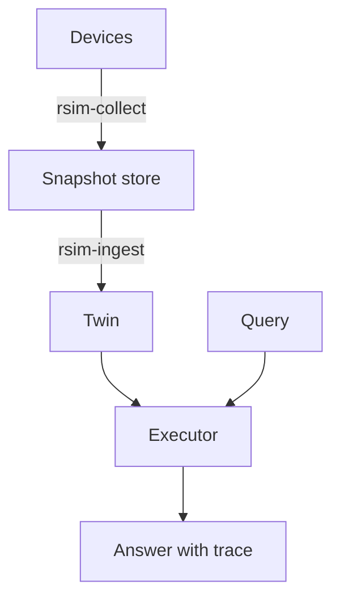

# rsim

rsim is a Rust engine for a network digital twin. It compiles device configs and collected state into network functions, and sends packets or packet sets through them. Each answer has a trace.

## How it works



1. `rsim-collect` reads each device with read-only commands and writes the answers to an append-only snapshot store.
2. `rsim-ingest` reads one snapshot. It classifies each config stanza as handled, known-irrelevant or unhandled, and lowers the handled stanzas and the collected rows into function instances.
3. The twin build checks the composition of the functions. The twin is immutable and is built again from the store.
4. The executor sends the packet set of the query from the ingress function. Each function splits its input into branches, and the executor follows each branch to its outcome. For each delivered branch, it then runs the reply.

Sessions and NAT translations are in a `FlowState` value that the query carries. Each function keeps the file and the line range from which it came. A result that the engine cannot decide is `Unknown` with a reason.

### Router functions

| Function | Action on the packet set |
|---|---|
| `Ingress` | Records the ingress interface. |
| `VrfSelection` | Sets the VRF from the interface. |
| `ZoneLookup` | Sets the source zone. |
| `SessionLookup` | Passes the packets of a session in the flow state. |
| `DestinationNat` | Rewrites the destination address and port. |
| `PolicyRoute` | Selects a route table by policy. |
| `RouteLookup` | Splits the set by next-hop group. Equal-cost paths give a forwarding choice. Packets to the router go to `LocalInput`. |
| `ZoneLookup` | Sets the destination zone. |
| `FirewallPolicy` | Splits the set into accepted and dropped packets, with the rule that decided. |
| `SourceNat` | Rewrites the source address and port. |
| `SessionCommit` | Adds the session to the flow state. |
| `NextHopResolution` | Finds the egress interface and the MAC of the next hop. |
| `Egress` | Sends the set on the link to the next device. |

A switch uses `PortIngress`, `MacLookup`, and `PortEgress` or `Flood`. `Layer3HandOff` gives the packets from a switch port to a router.

A VXLAN tunnel end uses `VxlanEncap` and `VxlanDecap`. `VxlanEncap` puts the packets of a VRF or a bridge domain in an outer header to the peer tunnel end, and the underlay routes the outer header. `VxlanDecap` takes the packets to a local tunnel end out of the tunnel, and the VNI selects the VRF or the bridge domain. `MulticastLookup` replicates the packets to a multicast group to the outgoing interfaces of the collected multicast routes, after the reverse path check.

## Crates

| Crate | Contents |
|---|---|
| `rsim-core` | Packets, packet sets, context, flow state, outcomes, traces |
| `rsim-dd` | Reduced ordered binary decision diagrams with complement edges, for the packet sets |
| `rsim-functions` | The network functions: forwarding, layer 2, routing, ACL, firewall policy, NAT, sessions, VXLAN tunnel ends |
| `rsim-engine` | The twin, the executor, verdict aggregation, the return path |
| `rsim-store` | The append-only snapshot store: the format, the writer and the reader |
| `rsim-collect` | The collectors: SSH and HTTPS transports, jump hosts and proxies, the vendor sources |
| `rsim-ingest` | The stanza reader, the coverage report and the lowering of each vendor into functions |
| `rsim-topologies` | The hand-built topologies |
| `rsim-contract` | The contract types and the registry of operations, with their JSON Schema; no engine dependency |
| `rsim-cli` | The command `rsim` |
| `rsim-api` | The REST API with its OpenAPI 3.1 contract, on a loopback address |
| `rsim-mcp` | A Model Context Protocol server on stdio |

## Build

You need Rust 1.99 or later.

| Task | Command |
|---|---|
| Build | `cargo build --workspace` |
| All tests | `cargo test --workspace` |
| One test file | `cargo test -p rsim-engine --test forwarding` |
| One test | `cargo test -p rsim-engine --test forwarding <test_name>` |
| Lint | `cargo clippy --workspace --all-targets` |
| Format check | `cargo fmt --all --check` |
| Path query benchmark | `cargo bench -p rsim-engine --bench single_path` |
| Memory per device | `cargo bench -p rsim-engine --bench memory` |
| Decision diagram operations | `cargo bench -p rsim-dd --bench ops` |

## Queries with rsim

The topology is a built-in name or `store:<data folder>`, the newest snapshot of a store. The built-in names are `mini-enterprise`, `edge-dnat`, `ecmp`, `routing-loop`, `hairpin`, `chain` and `leaf-spine`.

| Task | Command |
|---|---|
| List the topologies | `cargo run -p rsim-cli -- topologies` |
| List the devices, functions, endpoints and attachment records | `cargo run -p rsim-cli -- devices mini-enterprise` |
| Run a path query with its reply | `cargo run -p rsim-cli -- path mini-enterprise --source.ip 172.31.10.20 --destination.ip 10.20.0.53 --network.transport udp --source.port 40000 --destination.port 53` |
| Show one trace step | `cargo run -p rsim-cli -- explain mini-enterprise --source.ip 172.31.10.20 --destination.ip 10.20.0.53 --network.transport udp --destination.port 53 --branch 0 --step 7` |
| Show one trace step of the reply of branch 0 | Add `--reply-of 0` to the `explain` command |
| Get JSON | Add `--format json`. Add `--pretty` for indented JSON. |
| Run a set query | `cargo run -p rsim-cli -- set mini-enterprise --source.ip 172.31.10.0/24 --destination.ip 10.20.0.53 --network.transport udp,tcp` |
| Show one trace step of a set query | Use `explain-set` with the flags of `set`, `--branch` and `--step` |
| Show all flags | `cargo run -p rsim-cli -- path --help` |

The query flags are `--source.ip`, `--destination.ip`, `--network.iana_number`, `--network.transport`, `--source.port`, `--destination.port`, `--source.mac`, `--destination.mac`, `--network.vlan.id`, `--l2_priority`, `--tcp_flags`, `--icmp_type`, `--icmp_code`, `--dscp`, `--ecn`, `--fragment`, `--ingress` and `--no-reply`. `--tcp_flags` takes a comma-separated list, for example `syn,ack`.

- A path query needs `--source.ip`, `--destination.ip`, and `--network.iana_number` or `--network.transport`.
- `--ingress <device>/<interface>` gives the ingress. Without it, the attachment records of the source address give the ingress.
- In a path query, a field that the query does not state is not known. If the result depends on it, the summary is `unknown`.
- In a set query, each flag takes an address, a prefix, a number, a range such as `1-1023`, or a comma list. A field that is not given has all values. The answer has a part for each different result.

The exit code is 0 for an answer, 1 for a query error and 2 for a usage error. `Drop` and `Unknown` are answers.

The JSON output has the field `rsim_json` with the version number 2. A packet set is a list of members, and each member is a product of field values.

## MCP server

`rsim-mcp` is a Model Context Protocol server on stdio. It supports the protocol revisions `2026-07-28` and `2025-11-25`. It writes no files.

1. Build the server with `cargo build --release -p rsim-mcp`.
2. Add `target/release/rsim-mcp` to your MCP client as a stdio server. Add `--store <data folder>` to use the topology `store`.

| Tool | Arguments | Result |
|---|---|---|
| `list_devices` | `topology` | The devices, functions, endpoints, attachment records and edge interfaces |
| `path_query` | `topology` and the query fields of `rsim path` | The answer with the ingress, the trace and the reply |
| `set_query` | `topology` and the query fields; each takes a set | The parts of the set with their results, the traces and the replies |
| `explain_step` | The query fields, `branch`, `step`, the optional `reply_of` and `mode` (`path` or `set`) | One trace step |

The JSON of a tool result is the same as the output of `rsim` with `--format json`.

## REST API

`rsim-api` serves the twins, tables, queries and claims as REST resources on a loopback address. The contract is the OpenAPI 3.1 document in `crates/rsim-api/openapi.json`.

```
cargo run -p rsim-api -- --listen 127.0.0.1:8787
```

| Resource | Request |
|---|---|
| The table catalog | `GET /v1/tables` |
| The rows of a table | `GET /v1/twins/builtin.leaf-spine/tables/fib/rows?device=leaf1&vrf=tenant` |
| A route lookup | `GET /v1/twins/builtin.leaf-spine/tables/fib/lpm?device=leaf1&address=10.2.0.10` |
| A query | `POST /v1/twins/builtin.leaf-spine/queries` with the fields of `rsim path` as a JSON object; the answer is 303 to the query resource |
| The answer | `GET` the query resource, with `?form=summary`, `steps` or `full` |
| A claim on the paths of the query | `GET <query resource>/claims/no-unknown` |

The same server gives the MCP tools at `POST /mcp`, the Streamable HTTP transport of MCP, so many agents can share one server and its twins. Add `--store <data folder>` for the twin `store`, which redirects to its snapshot `snap-<cycle>`. A browser needs `--allow-origin <origin>`. The server has no authentication yet, so it accepts only a loopback listen address.

## License

MIT
